  

### 🛠️ Now building

| Project | What it does | Stack | Status |
|---|---|---|---|
| [**toolcall-bench**](https://github.com/korearn/toolcall-bench) | Deterministic tool-calling evals for local LLMs that fit in 16 GB of VRAM. Same suite against every model; pass rate, consistency, speed and VRAM side by side. | Python · Ollama · SQLite · uv | 🟡 pre-alpha → `v0.1.0` |
| [**LeOS**](https://github.com/korearn/leo-os) | My hand-made corner of the web, no frameworks. "Midnight Aero" look; the *Now* section and game shelf sync from my Obsidian vault via Python. | HTML · CSS · Python | 🟢 [live](https://leo-os.neocities.org) |
| [**Shizuka 静か**](https://github.com/korearn/shizuka) | Zero-noise project scaffolder CLI. Clean structures, no bloat, Tokyo Night palette. | Python | 🟡 early |

### 🧩 Side quests

| Project | What it does | Stack |
|---|---|---|
| [**LyonX**](https://github.com/korearn/lyonx-analyzer) | League of Legends tactical analyzer: Riot API match telemetry → coaching report from a local LLM, saved for history. | Flask · PostgreSQL · Docker · LM Studio |
| [**Spotify Deconstructor**](https://github.com/korearn/spotify-deconstructor) | Pulls my recent top tracks and drops a ready-to-fill Obsidian note to deconstruct their arrangements. | spotipy · rich |
| [**Neon Watcher**](https://github.com/korearn/neon-watcher) | Cyberpunk terminal system monitor with LLM-generated status reports. | rich · psutil · LM Studio |
| [**Music Analyzer**](https://github.com/korearn/music-analyzer) | Analyzes chord progressions and styles. | Python |

### 🧪 How I like to build

- **Local-first.** If it can run on my own hardware, it does.
- **Small tools, real problems.** One thing, done well, with a README you can follow.
- **Boring infra, interesting logic.** Linux, Bash, Docker, cron — then the fun part.

### 🧰 Stack

  

**AI:** LangGraph · Strands Agents · Ollama · LM Studio · ChromaDB · scikit-learn

📦 <b>Archive</b> — fintech & banking portfolio

 

| Project | Description | Stack |
|---|---|---|
| [TX-Classifier](https://github.com/korearn/tx-classifier) | NLP transaction categorization with local LLMs | Python · SQLite · LM Studio |
| [Bank Reconciliation](https://github.com/korearn/bank-reconciliation) | Automated discrepancy detection | Python · Pandas · Bash |
| [Exchange Rate API](https://github.com/korearn/exchange-rate-api) | REST microservice with caching and fallback rates | FastAPI · SQLite · Docker |
| [Infra Monitor](https://github.com/korearn/infra-monitor) | System monitoring with LLM-generated diagnostics | psutil · Bash · LM Studio |
| [ETL Pipeline](https://github.com/korearn/etl-pipeline) | Financial + weather data into PostgreSQL | Pandas · cron · PostgreSQL |
| [Credit Scoring API](https://github.com/korearn/credit-scoring-api) | ML credit scoring with generated explanations | scikit-learn · FastAPI |
| [Financial RAG](https://github.com/korearn/financial-rag) | Document Q&A over financial PDFs | ChromaDB · sentence-transformers |

### 🎸 Off the keyboard

Guitar, bedroom music production and way too many games in the backlog.

---

  <a href="https://www.linkedin.com/in/leonardoleonh/">LinkedIn</a> ·
  <a href="mailto:leo.dleon55@gmail.com">Email</a> ·
  <a href="https://ko-fi.com/leoleon_">Ko-fi</a>

